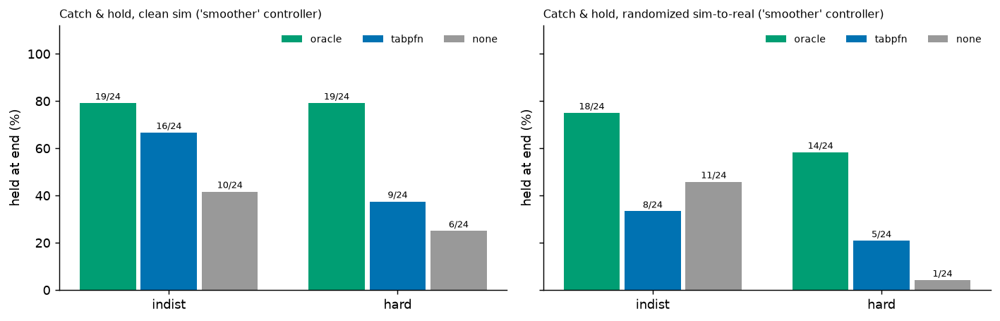

# SmolVLA + TabPFN: an SO-101 arm that catches a rolling ball

An SO-101 robot arm in MuJoCo catches and holds a rolling red ball. **TabPFN** forecasts where and when the ball will arrive
from its tracked positions; **SmolVLA** (fine-tuned from `lerobot/smolvla_base`) turns camera images, joint state and that
forecast into joint commands. Built for the Prior Labs spatial-awareness challenge.

**Everything here is simulation only. Nothing has been run on real hardware.** Sample sizes are small (24 launches per
condition; one standard error is about ±10 points), and there is one training run per stage.

## Headline results (24 launches per cell, 12,000-step checkpoint, "smoother" controller)

| Target given to the policy | clean, in-dist | clean, hard | randomized, in-dist | randomized, hard |
|---|---|---|---|---|
| exact (oracle) forecast | 19/24 | 19/24 | 18/24 | 14/24 |
| TabPFN forecast | 16/24 | 9/24 | 8/24 | 5/24 |
| no forecast | 10/24 | 6/24 | 11/24 | 1/24 |
| scripted expert (16 launches, pre-filtered to be solvable) | 16/16 | 16/16 | 15/16 | 15/16 |

"Held" = at the end of the episode the ball is lifted (centre above 3.5 cm) and within 9 cm of the gripper. "Hard" launches
add a hidden rough patch, a slope and an unpredictable mid-roll nudge. "Randomized" = camera, lighting, colours, actuator
gains, state noise, 0–3 steps of latency and a servo speed limit. See [docs/RESULTS.md](docs/RESULTS.md) for every number,
the graphs and what each one does and does not show.



What the results say, plainly:

1. **The policy learned to catch** when it is given an exact forecast (19/24, about 80%, against 0/24 for doing nothing).
2. **The TabPFN forecast helps on in-distribution launches but not on hard ones.** The forecast itself is good
   (median error 0.2–0.7 cm in-distribution, better than constant velocity), but on hard launches a nudge cannot be
   predicted early, and the policy pre-positions from the early forecast. The gap to the oracle is mostly this, plus the policy
   not trusting the noisy numbers (see the stage-3 result in [docs/EXPERIMENT_LOG.md](docs/EXPERIMENT_LOG.md)).
3. **Smoothness is the weak point.** Jerk is 9k–16k deg/s³ after smoothing against about 1.6k for the scripted expert, so a
   catch scores about 0.3 points instead of 0.93 (the score divides a threshold of 4000 by the jerk).
4. **Real-world inputs** (no blue target marker, ball position from an HSV colour detector only): the HSV detector is accurate
   (0.05 cm clean, 2 cm randomized) and costs little, but with the marker hidden the policy collapses on hard launches with
   TabPFN targets (1–2/24 vs 9/24), because it was trained with the marker. Retraining without it is the first TODO item
   ([details](docs/RESULTS.md#4-real-world-inputs-no-marker-hsv-only-tracking)).

Example rollouts (clean sim, exact forecast, then TabPFN forecast on a hard launch): [docs/gifs/](docs/gifs/) (`big_smoother_clean_indist_oracle_0.gif`, `big_smoother_clean_hard_oracle_0.gif`, `big_smoother_clean_hard_tabpfn_0.gif`). Each shows the top and front camera views.

## How it works

```
 top camera ──► HSV red-ball detector ──► (x, y, t) track ──► TabPFN forecaster ──► crossing y, arrival time, sigma, path
      │                                                                                     │
      └── images (2 cameras) ──┐                                                            ▼
          joint state (6) ─────┼──► SmolVLA (50-step action chunks) ◄── 6 forecast numbers appended to the state
          task text ───────────┘            │
                                            ▼
                     smoothing controller (fixed noise, chunk blending, EMA) ──► safety filter ──► SO-101 joints
```

- **Forecaster** ([challenge/sim/forecast.py](challenge/sim/forecast.py)): two TabPFN v2 regressors on trajectory rows,
  predicting the crossing position and time at the catch plane x = 0.24 m with an uncertainty band.
- **Scripted catch expert** ([catch_expert.py](challenge/sim/catch_expert.py), [catch_ik.py](challenge/sim/catch_ik.py)):
  the teacher. The gripper mouth faces the ball, wrist rolled about −90°, jaws open sideways, closes 0.25 s early, then lifts.
- **Training data**: 400 expert demonstrations (37,636 frames) with mixed targets (30% exact, 50% TabPFN, 20% constant velocity)
  so the policy cannot learn to ignore the target. 25% clean, 75% randomized for sim-to-real.
- **Smoothing and safety** ([smooth_controller.py](challenge/sim/smooth_controller.py), [safety.py](challenge/sim/safety.py)):
  see [DEPLOYMENT_SAFETY.md](DEPLOYMENT_SAFETY.md).
- **Spatial brain experiment** ([spatial_brain.py](challenge/sim/spatial_brain.py)): TabPFN as a classifier that picks a zone
  with a confidence, an uncertainty gate and few-shot adaptation to a rule change. Results in
  [docs/RESULTS.md](docs/RESULTS.md#5-tabpfn-spatial-brain-zone-prediction-uncertainty-gate-few-shot-adaptation).

## Repository map

| Path | What it is |
|---|---|
| `challenge/sim/` | MuJoCo environment, experts, forecaster, recorders, evaluators, sim-to-real layer, HSV tracker, safety filter |
| `challenge/sim/so101_tabletop/` | SO-101 MuJoCo model from `lerobot/so101-tabletop-mujoco` (Apache-2.0) |
| `scripts/` | pipelines (PowerShell), dataset merge, figure generation |
| `train_ball.ps1` | SmolVLA fine-tuning wrapper around `lerobot-train` |
| `results/`, `docs/figures/` | evaluation JSON, summary and graphs |
| `docs/` | [RESULTS](docs/RESULTS.md), [REPRODUCE](docs/REPRODUCE.md), [EXPERIMENT_LOG](docs/EXPERIMENT_LOG.md), [TODO](docs/TODO.md), [LIBERO_LEGACY](docs/LIBERO_LEGACY.md) |
| `DEPLOYMENT_SAFETY.md` | command path, safety layers, pre-flight checklist for a real arm |

Datasets, checkpoints (several GB) and the Python environment are **not** in the repository; REPRODUCE explains how to
regenerate them. The earlier LIBERO / Franka work is kept in [docs/LIBERO_LEGACY.md](docs/LIBERO_LEGACY.md).

## Status and next steps

Open items are in [docs/TODO.md](docs/TODO.md). The most important: retrain without the blue marker so the policy relies on the
numeric forecast only, and bring the arm's jerk down to the expert's level.
