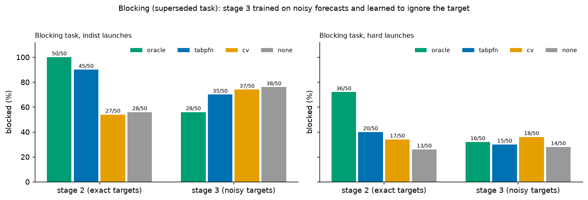
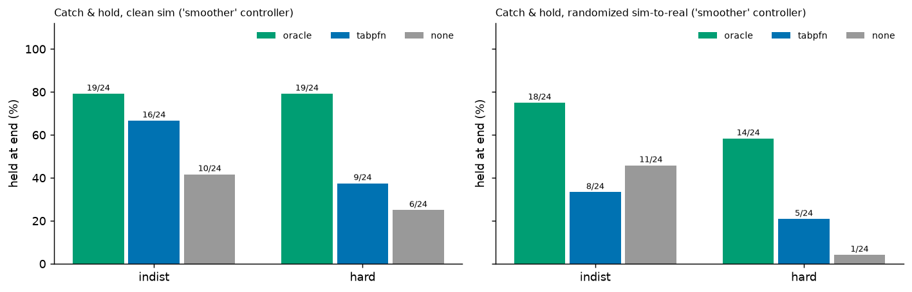
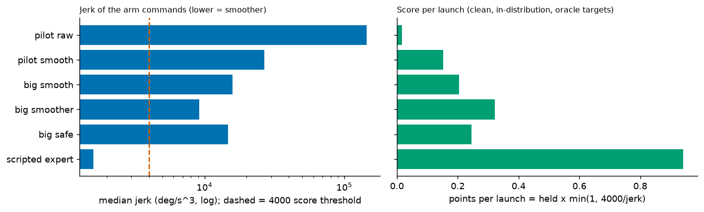
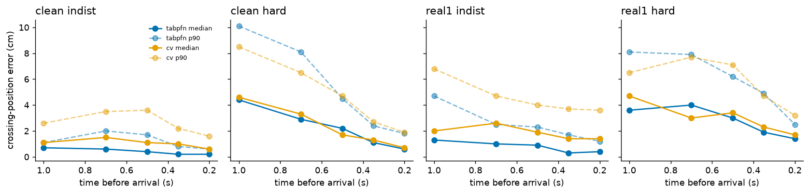
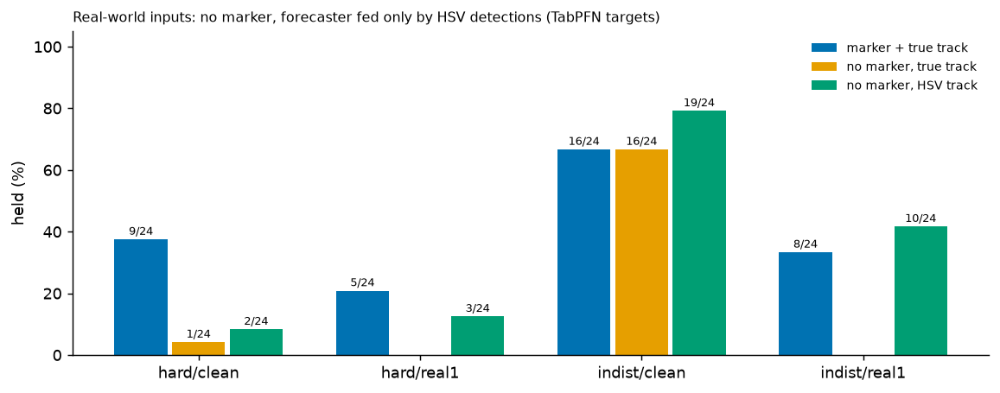
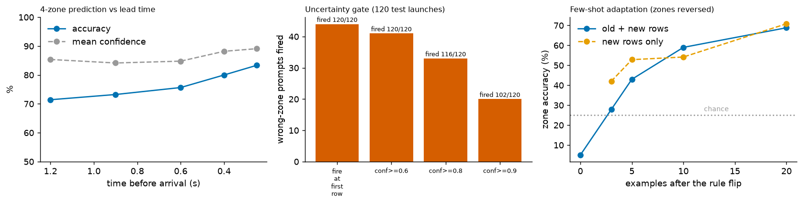

# Results

All numbers are from simulation. "n" is the number of launches in a cell: 24 for the big run, 16 for the pilot. With n = 24 one
standard error is about ±10 percentage points, so differences of 2–3 launches are noise. There is one training run per stage.
Raw JSON: `results/` (copies of the evaluator output); a flat summary is in `results/summary.json`.

How to read a cell: **held** = at the end of the episode the ball centre is above 3.5 cm and within 9 cm of the gripper.
**Points** = held × min(1, 4000 / jerk), where jerk is the RMS third difference of the five arm-joint commands in deg/s³
(4000 is about the scripted expert's own jerk). **Splits**: *indist* = easy launches (0.10–0.28 m/s, plain friction);
*hard* = adds a rough patch, a lateral slope and, in 9 of 24 launches, an unpredictable mid-roll nudge.
**Launch selection caveat**: launches are drawn at random and kept only if the scripted expert can catch them. That keeps the
test fair for a policy trained on the expert, but only 67% of *hard* draws were solvable (100% of indist), so the hard split
excludes the hardest third. **Conditions**: *clean* = nominal simulator; *randomized* (`real1`) = sim-to-real randomization
described in [REPRODUCE.md](REPRODUCE.md#sim-to-real-layer).

## 1. Blocking stages (earlier, superseded task)

The first task was blocking the ball with a paddle. It produced the main lesson for the catch task.

- Stage 2 (exact targets in the training data): with the exact forecast the policy blocked 50/50 easy and 36/50 hard launches;
  with TabPFN targets 45/50 easy and 20/50 hard; with no target 28/50 and 13/50. The policy did use the target.
- Stage 3 (re-trained on demonstrations whose targets were the noisy forecasts): the policy **ignored** the target. Blocked
  rates are about equal for every target type, and the exact target (28/50 easy) is *worse* than none (38/50). The cause is that
  the demonstrations paired a noisy target with an action computed from the true crossing, so the target looked uninformative.
- Fix used for the catch task: the training targets are a mix of exact (30%), TabPFN (50%) and constant-velocity (20%) forecasts.

## 2. Catch and hold, pilot (3,000 steps) and big run (12,000 steps)

Both start from the stage-2 weights and train on `so101_catch_v2` (400 expert demonstrations, 37,636 frames).
Controller variants:
- *raw*: re-query the policy every 5 steps. *smooth*: fixed flow-matching noise, chunk blending, EMA 0.5.
  *smoother*: EMA 0.7. *safe*: smooth plus a per-step joint limit of 10°.
- **Every big-run row ("smooth", "smoother", "safe") also ran through the safety filter** (the evaluation was started with
  `--safety`), so "safe" differs from "smooth" only by the extra 10° step limit. That is why several randomized rows of the two
  are identical. The pilot rows did not use the safety filter.

Pilot (n = 16, TabPFN and oracle targets only):

| variant / condition | oracle held | TabPFN held | median jerk (oracle) |
|---|---|---|---|
| raw, clean, in-dist | 9/16 | 9/16 | 144k |
| smooth, clean, in-dist | 16/16 | 11/16 | 27k |
| smooth, clean, hard | 14/16 | 10/16 | 29k |
| smooth, randomized, in-dist | 13/16 | 8/16 | 32k |
| smooth, randomized, hard | 11/16 | 2/16 | 38k |

Big run (n = 24, 12,000 steps, all with the safety filter): the full table is in `results/summary.json`; selected rows are
below. "smoother" is the best variant on points.

| variant, condition | oracle held (points) | TabPFN held (points) | none held (points) |
|---|---|---|---|
| smoother, clean, in-dist | 19 (7.7) | 16 (4.3) | 10 (2.7) |
| smoother, clean, hard | 19 (6.8) | 9 (2.5) | 6 (1.7) |
| smoother, randomized, in-dist | 18 (5.5) | 8 (1.8) | 11 (2.4) |
| smoother, randomized, hard | 14 (3.4) | 5 (1.0) | 1 (0.2) |
| smooth, clean, hard | 22 (4.8) | 7 (1.3) | 5 (0.9) |
| safe, clean, hard | 23 (5.6) | 10 (1.7) | 8 (1.3) |

(points are summed over the 24 launches; a perfect run would score 24.) The scripted expert scores about 15 of 16
(0.93 per launch) at its own jerk of about 1.6k.

What this shows:
- Exact targets: 19–23 of 24 on clean launches. The policy learned the task.
- Smoothing cuts jerk 5–6× (raw 144k → 27k in the pilot; 9k–16k after more training and the "smoother" setting). It is still
  2–4× above the 4000 threshold, so the points are about a third of what they could be. Raising the smoothing costs some catches
  (19 vs 22 held on clean hard with oracle targets) but gains points (6.8 vs 4.8).
- Randomization costs catches (oracle in-dist 19 → 18, hard 19 → 14) and costs TabPFN targets much more (16 → 8 and 9 → 5).
  In randomized in-distribution launches, "none" (11) beat TabPFN (8); with n = 24 that is within noise, but it says the
  policy does not extract much from the forecast there.
- The "hold" part is real: in held launches the ball is lifted and stays with the gripper for 0.7 s after the lift.

## 3. Is TabPFN forecasting correctly?

Direct check of the forecast against the true crossing (24 launches per split, ball only, no arm; tracker noise 0.4 cm or the
randomized tracker): median and 90th-percentile error of the crossing position, by time before arrival.

| split / condition | lead 1.0 s | 0.5 s | 0.35 s | 0.2 s |
|---|---|---|---|---|
| in-dist, clean | 0.7 (p90 1.1) cm | 0.4 (1.7) | 0.2 (0.8) | 0.2 (0.6) |
| hard, clean | 4.4 (10.1) | 2.2 (4.5) | 1.1 (2.4) | 0.6 (1.8) |
| in-dist, randomized | 1.3 (4.7) | 0.9 (2.3) | 0.3 (1.7) | 0.4 (1.2) |
| hard, randomized | 3.6 (8.1) | 3.0 (6.2) | 1.9 (4.9) | 1.4 (2.5) |

TabPFN beats constant velocity on in-distribution launches at every lead (for example 0.7 vs 1.1 cm at 1.0 s) and on arrival
time (94 ms vs 202 ms at 1.0 s, clean). On hard launches the two are close on position (4.4 vs 4.6 cm at 1.0 s, clean; TabPFN
is slightly worse at 0.7 s randomized). **Conclusion:** the forecast is not broken; it is accurate late and fairly accurate
early on easy launches. On hard launches, a nudge can happen after the arm has already committed, and no forecaster can predict
it. This is a likely, not proven, explanation of the 19 vs 9 gap between exact and TabPFN targets on hard launches; an
experiment that fixes the nudge to be known would settle it.

**A failed idea:** hiding the TabPFN target from the policy until 0.6 s before arrival (an "uncertainty gate" on the input)
collapsed the result to 2/24 on clean hard launches (ungated: 9/24, no target: 6/24). The policy needs the early forecast to start
moving. A gate on the close/lift command, not on the input, is the thing to try (see the TODO).

## 4. Real-world inputs: no marker, HSV-only tracking

In simulation the original setup drew the forecast crossing point into the camera image as a blue dot. A real camera cannot do
that, and the real tracker would be a colour or YOLO detector. Two ablations (TabPFN targets, "smoother", clean unless noted):

- **Marker hidden, ball position still exact**: oracle targets hold 19/24 hard and 17/24 in-dist (unchanged); TabPFN targets hold
  **1/24 on hard** (9/24 with the marker) and 16/24 in-dist (16/24 with the marker). On the easy split the numeric forecast is enough;
  on the hard split the policy was relying on the dot, which shows the noisy early forecast better than the 6 numbers did.
- **HSV detector as the only source for TabPFN** ([hsv_tracker.py](../challenge/sim/hsv_tracker.py)): threshold on hue/saturation/
  value of the top-camera image, largest round blob, pixel to table homography fitted from 35 known positions. Detection rate
  236/240 clean and 234/240 randomized; position error 0.05 cm median clean (p90 0.11 cm) and 2.0 cm median randomized
  (p90 3.5 cm; mostly a fixed camera-pose offset that an in-place calibration removes). Closed-loop, with the marker hidden: see the
  figure and the table below. HSV tracking costs little where the marker-off result was already fine (in-dist clean 19/24 vs
  16/24 with the true track, within noise; randomized in-dist 10/24 vs 8/24 with the marker and true track).

| TabPFN targets, "smoother" | in-dist clean | hard clean | in-dist randomized | hard randomized |
|---|---|---|---|---|
| marker, true ball track (big run) | 16/24 | 9/24 | 8/24 | 5/24 |
| no marker, true ball track | 16/24 | 1/24 | not run | not run |
| no marker, HSV track | 19/24 | 2/24 | 10/24 | 3/24 |

(Differences of 2–3 launches are within noise.) **Take-away for deployment:** the HSV tracker is accurate enough; the limiting factor
is that the policy was trained with the marker. Retraining without the marker is the first item in the [TODO](TODO.md).

## 5. TabPFN "spatial brain": zone prediction, uncertainty gate, few-shot adaptation

[spatial_brain.py](../challenge/sim/spatial_brain.py), no policy in the loop. TabPFN as a **classifier** predicts which of 4 zones
(y-bands across the lane at the catch plane) the ball will reach, with a confidence. A confidence gate fires the zone prompt
("Catch the red ball in zone k and hold it") only when confident. Trained on 500 simulated launches (2,000 rows), tested on 120.

| gate | prompts fired | correct of fired | wrong-zone prompts | mean lead when fired |
|---|---|---|---|---|
| fire at the first prediction | 120/120 | 63% | 44 | 1.13 s |
| confidence ≥ 0.6 | 120/120 | 66% | 41 | 1.11 s |
| confidence ≥ 0.8 | 116/120 | 72% | 33 | 1.00 s |
| confidence ≥ 0.9 | 102/120 | 80% | 20 | 0.83 s |

The gate more than halves wrong-zone prompts, at the price of firing about 0.3 s later and holding on 15% of launches.
Few-shot adaptation after a hidden rule flip (zones reversed; the rows carry a session id): accuracy rises from 5% (old context
only) to 28% / 43% / 59% / 69% with 3 / 5 / 10 / 20 new examples, with no retraining; using only the new examples is better
at 3–5 examples (42% / 53%) and equal at 20. Chance is 25%. This is a simulated zone task, not LIBERO or a real cup placement.

## 6. Not done

LIBERO benchmark numbers for the spatial brain, a multi-zone SO-101 fine-tune, the live few-shot adaptation of the ball
forecaster, a deterministic fallback executor, and anything on real hardware. See [TODO.md](TODO.md).
